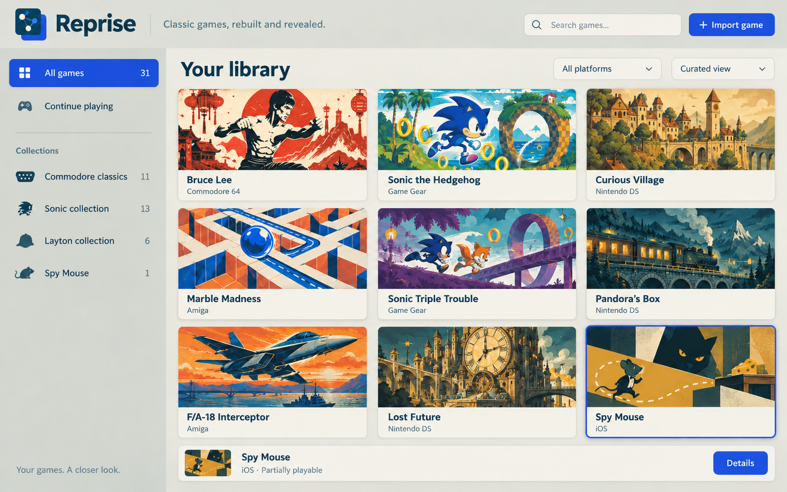

# Reprise

**Classic games, rebuilt and revealed.**

Reprise brings clean C++ re-implementations of older games into one SDL 3
application: a shared library, asset import, game details, persistent quick
saves, enhancements and a look behind the curtain through illustrated lessons
and live demonstrations. It grows out of Joyport, BlueStreak, Picarat and
DoubleOCheese. It runs reconstructed game logic natively, not through an emulator.



*Design concept: some pictured controls and future entries are not implemented.*

Supply your own supported game images. No commercial game ROM, disk image, IPA
or extracted game asset pack is distributed with Reprise. Small legacy system
font/imagery exceptions are identified in [NOTICE.md](NOTICE.md).

## What works today

Status as of **29 October 2026**. “Connected” means the game can be imported and
opened in Reprise; it does not mean every part of the original is reconstructed.
Each game's `plan.md` lists remaining work and known bugs.

| Game | Platform | Current Reprise support |
| --- | --- | --- |
| Fort Apocalypse | C64 | Playable from title to debrief |
| Bruce Lee | C64 | Playable through the ending and next round, including two-player modes; three lessons |
| Wizball | C64 | Whole-game reconstruction; see its plan for remaining verification |
| Mind Walker | Amiga | Connected gameplay, persistent saves and a sequence-by-sequence player guide |
| Marble Madness | Amiga | All six courses and one-player flow; three lessons |
| Wings of Fury | Amiga | Story, rank selection and all fifteen missions |
| Cannon Fodder | Amiga | First ten maps; front end, briefings, recruits and vehicles remain incomplete |
| Rock ’n Roll | Amiga | Partial level play; front end, some items/cells, panel and music remain incomplete |
| F/A-18 Interceptor | Amiga | Free-flight prototype; menus, weapons and other aircraft remain incomplete |
| Spindizzy Worlds | Amiga | Per-level movement test drive; active objects, front end, sound and other systems remain incomplete |
| Tower of Babel | Amiga | Import and decoded-asset viewer; no playable entry currently connected |
| Spy Mouse | iOS | Connected IPA import and partial campaign; version 1.1.1 differences and later content remain under validation |

The **Sonic collection** contains Sonic the Hedgehog, Sonic the Hedgehog 2,
Sonic Triple Trouble and Sonic Advance, in that order. Their BlueStreak engines
are included, but Reprise's cards are currently **Coming to Reprise**: import
and gameplay adapters are not yet connected. The family README and docs describe
the existing standalone engines, including Sonic Advance's incomplete modes.

The **Layton collection** contains Curious Village, Pandora's Box, Lost Future,
Spectre's Call, Miracle Mask and Azran Legacy. Picarat's engines are included;
these six entries also remain catalog previews pending Reprise integration.
Standalone progress varies substantially between games. See
[Layton's per-game docs](games/layton/docs/README.md).

Captain Toad / Diorama is a planned future integration and is not included yet.
Collections are optional: Spy Mouse belongs to All games without its own collection.

## Shared experience

- Portrait and landscape collection browsing, themed artwork, smooth shelf
  scrolling and explicit unavailable/import status. Opening a card shows details.
- Portrait details and documentation, imported asset viewers, development notes
  and lesson browsing. Individual lesson experiments retain their existing canvases.
- Continue playing sorted by the newest validated save timestamp. Other library
  views generally sort by platform release year; Sonic uses the order above.
- Persistent quick save/load with screenshots for Fort Apocalypse, Bruce Lee,
  Wizball, Mind Walker, Marble Madness, Wings of Fury, Cannon Fodder and Spy Mouse.
  Other modules still need persistent-save integration.
- Shared pause/options menus and game-specific cheats/enhancements where implemented.
- VHS effects for CPU-rendered games and a shared GPU filter stage, first used
  by Spy Mouse. GPU shaders are available through SDL's GPU renderer; other
  renderers use a CPU fallback whose cost on slower devices is not yet measured.
- Keyboard, pointer/touch and gamepad plumbing. Individual games' touch/gamepad
  adaptations vary; a working launcher does not imply every game is phone-playable.

Reprise's interface and rendering use SDL; platform document selection is
accessed through SDL. Filters affect gameplay, keeping app menus and save/load
notifications sharp. Original gameplay remains separate from optional enhancements.

## Build and test

### macOS

Install CMake, Ninja, SDL 3.4 or newer, and the FreeType development dependency
used by Spy Mouse (plus zlib). Then:

```sh
./build.sh
ctest --test-dir build --output-on-failure
```

The self-contained app is `build/Reprise.app`. `Play Reprise.command` builds on
first use and launches the app. The bundled shader headers are checked in;
regenerating them requires the tools documented in `tools/build_shaders.py`.

### Android

```sh
./build-android.sh
# Optional: install on a USB-debugging device
./build-android.sh --install
```

Output: `build-android/Reprise.apk`, a debug-signed ARM64 test package. See
[Android prerequisites and installation](targets/android/README.md) for the
SDK/NDK/JDK versions and device selection. Intended test devices include the
AYN Thor and Galaxy S26 Ultra. Builds and emulator startup have been checked;
full physical-device gameplay, controls and filter performance remain to be tested.

### Other desktops

The shared code targets portable C++20/SDL 3 and uses CMake. Linux has received
build checks; Windows and broad device/runtime coverage remain outstanding.
Do not interpret portability as a claim that every target has been validated.
See [validation notes](docs/VALIDATION.md) for the exact scope.

## Using the library

Choose **Import game** and select a supported image. Multi-disk games require
all required disks. Reprise identifies accepted releases and installs decoded
content in its own writable data directory. Keep your original images separately.

Choose a card, then **Start** or **Continue**. **Documentation** opens assets,
development notes and available lessons or guides. Arrow keys/gamepad navigate;
Enter opens a selection; Escape returns or opens the pause menu. The shared
quick-save shortcuts are Cmd+S/Cmd+L on macOS and Ctrl+S/Ctrl+L elsewhere.

Save states are outside imported game files; deleting a game's imported content
keeps its quick save. An Android app uninstall removes its private application data.

## Source and contribution guide

- `app/`: launcher, catalog, imports, saves and menu orchestration.
- `shared/`: platform services, UI, effects, serialization and shared data formats.
- `games/`: game engines; `layton` and `sonic` are shared engine families.
- `collections/`: optional grouping and visual themes.
- `resources/`: catalog artwork, interface fonts and notices.
- `targets/`: platform packaging and Android setup.
- `images/`: ignored local source images; never packaged or committed.

Start with [ADDING_A_GAME.md](ADDING_A_GAME.md) and
[RECONSTRUCTION.md](RECONSTRUCTION.md). Keep `plan.md` and `game.md` up to date:
standalone games keep them in their folder, Layton under `layton/docs/<game-id>/`,
and Sonic in [sonic/docs](games/sonic/docs/plan.md). See the
[documentation audit](docs/GAME-DOCUMENTATION-AUDIT.md) and
[migration record](docs/MIGRATION.md).

## License

Reprise's original code and documentation are licensed under the
[MIT License](LICENSE), copyright © 2026 StupidCoder.

**The C64 and Amiga system-font data are excluded from that MIT grant.** Existing
Amiga system-gadget imagery is also excluded. Third-party libraries and fonts
retain their own licenses. See [NOTICE.md](NOTICE.md) for exact locations and
attributions. No license to original games, their data or trademarks is granted.
Reprise is an independent project, not affiliated with the original publishers
or platform manufacturers.
