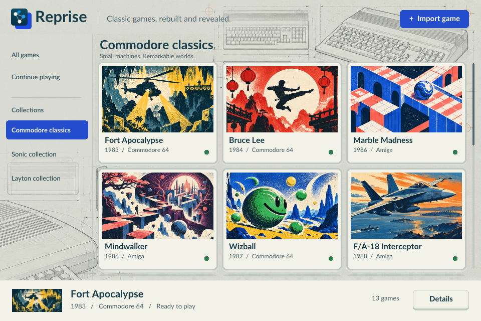

# Reprise

**Classic games, rebuilt and revealed.**

Reprise brings clean C++ re-implementations of older games into one SDL 3
application: a shared library, asset import, game details, persistent quick
saves, enhancements and a look behind the curtain through illustrated lessons
and live demonstrations. It runs reconstructed game logic natively, not through
an emulator.



Supply your own supported game images. No commercial game ROM, disk image, IPA
or extracted game asset pack is distributed with Reprise. Small legacy system
font/imagery exceptions are identified in [NOTICE.md](NOTICE.md).

## What works today

Status as of **30 October 2026**. Support ranges from asset viewers to games
playable through their endings. Each game's `plan.md` records remaining work,
known bugs and validation gaps.

| Game | Platform | Current Reprise support |
| --- | --- | --- |
| Fort Apocalypse | C64 | Playable from title to debrief |
| Bruce Lee | C64 | Playable through the ending and next round, including two-player modes; three lessons |
| Wizball | C64 | Playable through the whole game, with menus, sound and bonus stages |
| Mind Walker | Amiga | Playable through all four stages to the finale, with saved worlds and a player guide |
| Marble Madness | Amiga | All six courses and one-player flow; three lessons |
| Wings of Fury | Amiga | Story, rank selection and all fifteen missions |
| Cannon Fodder | Amiga | First ten maps; front end, briefings, recruits and vehicles remain incomplete |
| Rock ’n Roll | Amiga | Playable from title to ending, with all levels, items, records, music and sound |
| F/A-18 Interceptor | Amiga | Free flight with take-off, landing, cockpit instruments and sound; menus, weapons and other aircraft remain incomplete |
| Spindizzy Worlds | Amiga | Playable through both clusters and all 30 worlds to both endings, with menus, music and saves |
| Tower of Babel | Amiga | Playable game, tower designer, custom towers, saved positions, music and sound |
| Beach Volley | Amiga | Intro with music and voices, players menu and court previews; matches are not playable yet |
| Stunt Car Racer | Amiga | Import, loading picture and eight circuits viewable as 3D models; no playable racing yet |
| Sonic the Hedgehog | Game Gear | Playable through both endings |
| Sonic the Hedgehog 2 | Game Gear | Playable through both endings; some paths still need comparison with the original |
| Sonic Triple Trouble | Game Gear | Playable to the ending; some paths remain incomplete or unverified |
| Sonic Advance | Game Boy Advance | Playable as Sonic to the ending; other characters, several modes and persistent saves remain incomplete |
| Professor Layton and the Curious Village | Nintendo DS | Story through the credits, all puzzles, minigames and bonus section; five European languages |
| Professor Layton and Pandora’s Box | Nintendo DS | Story and post-game, all 187 puzzles and minigames; some presentation differences and one missing room |
| Professor Layton and the Lost Future | Nintendo DS | Story through the credits, all 224 puzzles and three minigames; some supplementary menus remain incomplete |
| Professor Layton and the Spectre’s Call | Nintendo DS | Story through the credits, 228 puzzles, minigames and bonus section; some scenery and faces are approximated |
| Professor Layton and the Miracle Mask | Nintendo 3DS | Story through the credits, all 150 puzzles and side games; some side-game features remain incomplete or unverified |
| Professor Layton and the Azran Legacy | Nintendo 3DS | Import and image previews; no playable story yet |
| Spy Mouse | iOS | Worlds 1–4, including secret levels and bosses, using version 1.1.1; later worlds and some accuracy work remain |

The Sonic games currently require physical controls. Layton uses touch or mouse
input and adapts its two screens to stacked or side-by-side layouts. Curious
Village supports the European edition; the other Layton entries currently use
the German editions. See [Sonic's support notes](games/sonic/docs/plan.md) and
[Layton's per-game documentation](games/layton/docs/README.md) for details.

## Shared experience

- Portrait and landscape collection browsing, themed artwork, smooth shelf
  scrolling and explicit unavailable/import status. Opening a card shows details.
- Portrait details and documentation, imported asset viewers, development notes
  and lesson browsing. Individual lesson experiments retain their existing canvases.
- Continue playing sorted by the newest validated save timestamp. Other library
  views generally sort by platform release year; Sonic follows the series order.
- Persistent quick save/load with screenshots and launcher Continue support.
  Availability varies by game; some adventures resume at a checkpoint.
- Shared pause/options menus and game-specific cheats/enhancements where implemented.
- Shared GPU-accelerated VHS filtering for software- and GPU-rendered games,
  with a CPU fallback when the renderer cannot run the shader.
- Keyboard, pointer/touch and gamepad plumbing. Individual games' touch/gamepad
  adaptations vary; a working launcher does not imply every game is phone-playable.

Reprise's interface and rendering use SDL; platform document selection is
accessed through SDL. Filters affect gameplay, keeping app menus and save/load
notifications sharp. Original gameplay remains separate from optional enhancements.

## Build downloads

GitHub can build the macOS app and Android APK on demand, or when a version tag
is pushed. Ordinary commits do not trigger builds. See [Build downloads](docs/BUILD_DOWNLOADS.md)
for setup, signing and release instructions.

## Build and test

### macOS

Install CMake, Ninja, SDL 3.4 or newer, and the FreeType development dependency
used by Spy Mouse (plus zlib). Then:

```sh
./build.sh
ctest --test-dir build --output-on-failure
```

The self-contained app is `build/Reprise.app`. `Play Reprise.command` builds on
first use and launches the app. The bundled shader headers are checked in;
regenerating them requires the tools documented in `tools/build_shaders.py`.

### Android

```sh
./build-android.sh
# Optional: install on a USB-debugging device
./build-android.sh --install
```

Output: `build-android/Reprise.apk`, a debug-signed ARM64 test package. See
[Android prerequisites and installation](targets/android/README.md) for the
SDK/NDK/JDK versions and device selection. Intended test devices include the
AYN Thor and Galaxy S26 Ultra. Game-specific control support varies: some games
are suited to touch, while others require a physical controller or keyboard.

### Other desktops

The shared code targets portable C++20/SDL 3 and uses CMake. Linux has received
build checks; Windows and broad device/runtime coverage remain outstanding.
Do not interpret portability as a claim that every target has been validated.
See [validation notes](docs/VALIDATION.md) for the exact scope.

## Using the library

Choose **Import game** and select a supported image. Multi-disk games require
all required disks. Reprise identifies accepted releases and installs decoded
content in its own writable data directory. Keep your original images separately.

Choose a card, then **Start** or **Continue**. **Documentation** opens assets,
development notes and available lessons or guides. Arrow keys/gamepad navigate;
Enter opens a selection; Escape returns or opens the pause menu. The shared
quick-save shortcuts are Cmd+S/Cmd+L on macOS and Ctrl+S/Ctrl+L elsewhere.

Save states are outside imported game files; deleting a game's imported content
keeps its quick save. An Android app uninstall removes its private application data.

## Source and contribution guide

- `app/`: launcher, catalog, imports, saves and menu orchestration.
- `shared/`: platform services, UI, effects, serialization and shared data formats.
- `games/`: game engines; `layton` and `sonic` are shared engine families.
- `collections/`: collection presentation and visual themes.
- `resources/`: catalog artwork, interface fonts and notices.
- `targets/`: platform packaging and Android setup.
- `images/`: ignored local source images; never packaged or committed.

Start with [ADDING_A_GAME.md](ADDING_A_GAME.md) and
[RECONSTRUCTION.md](RECONSTRUCTION.md). Keep `plan.md` and `game.md` up to date:
standalone games keep them in their folder, Layton under `layton/docs/<game-id>/`,
and Sonic in [sonic/docs](games/sonic/docs/plan.md). See the
[documentation audit](docs/GAME-DOCUMENTATION-AUDIT.md).

## License

Reprise's original code and documentation are licensed under the
[MIT License](LICENSE), copyright © 2026 StupidCoder.

**The C64 and Amiga system-font data are excluded from that MIT grant.** Existing
Amiga system-gadget imagery is also excluded. Third-party libraries and fonts
retain their own licenses. See [NOTICE.md](NOTICE.md) for exact locations and
attributions. No license to original games, their data or trademarks is granted.
Reprise is an independent project, not affiliated with the original publishers
or platform manufacturers.
